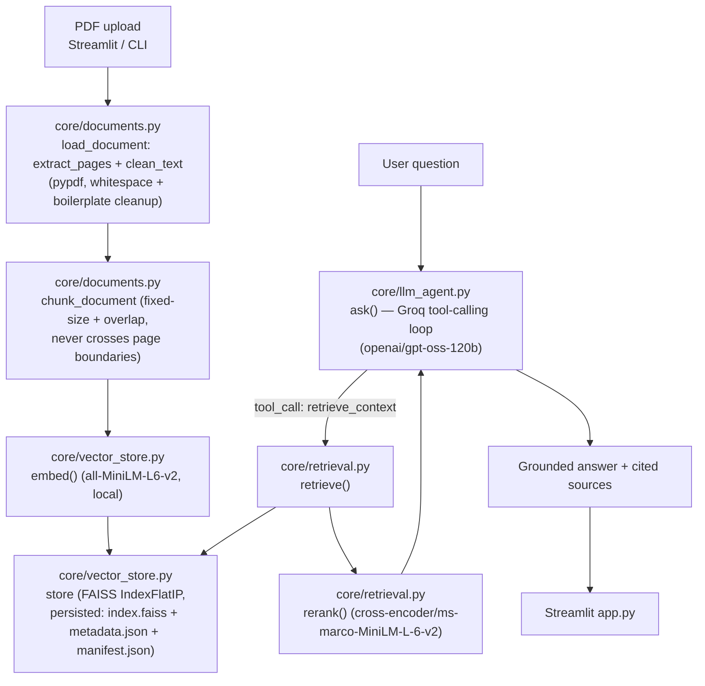
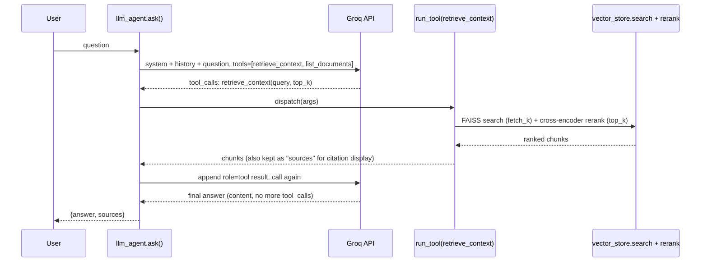

# Architecture

## Overview

The Document Assistant is a retrieval-augmented generation (RAG) pipeline built entirely in
vanilla Python — no LangChain/LangGraph/CrewAI. LLM calls, tool-call parsing/dispatch, and
conversation-history management are hand-rolled directly against the Groq SDK.

## Components

| Module | Responsibility |
|---|---|
| `core/config.py` | All settings in one place: data paths, model names, chunk size/overlap (800/150), retrieval fetch/top-k (20/5), `MAX_TOOL_ITERATIONS` (4). Loads `.env`. |
| `core/documents.py` | **Phases 1-2.** Ingestion: extracts per-page text via `pypdf`, strips repeated running headers/footers and page-number-only lines, normalizes whitespace, computes a sha256 hash of each file for dedup. Chunking: fixed-size (`chunk_size`, `overlap` arguments) character windowing per page. Chunks never span page boundaries, so citations stay page-accurate. |
| `core/vector_store.py` | **Phase 3.** `embed()` runs `sentence-transformers` (`all-MiniLM-L6-v2`, 384-dim, fully local/open-source, loaded once on first use) and L2-normalizes so FAISS inner product = cosine similarity. A module-level `store` dict holds the FAISS index, chunk list and ingested files; plain functions (`load_store`, `save_store`, `add_document`, `search`, `list_documents`, `clear_store`) work on it. On disk at `data/vector_store/`: `index.faiss` (FAISS `IndexFlatIP`), `metadata.json` (chunk text/page/source, position-aligned with the index), `manifest.json` (embedding model/dimension + ingested-file hashes for dedup). `load_store` raises `ValueError` if the persisted store was built with a different embedding model. |
| `core/retrieval.py` | **Phase 4.** `rerank()`: cross-encoder (`cross-encoder/ms-marco-MiniLM-L-6-v2`) that jointly scores (query, chunk) pairs — the explicit "ranking" phase, distinct from raw FAISS top-k. `retrieve()`: over-fetches 20 FAISS candidates, then reranks down to the top-k requested. |
| `core/prompts.py` | The project's prompt templates: `SYSTEM_PROMPT` (grounding + citation instructions), `CONTEXT_BLOCK_TEMPLATE`, `NO_RESULTS_MESSAGE`, and the `FALLBACK_*` templates used when the tool-calling cap is hit. |
| `core/llm_agent.py` | **Phase 5.** Groq tool JSON schemas (`TOOLS`: `retrieve_context`, `list_documents`) + `run_tool()` mapping tool name → real Python function, and `ask()` — the tool-calling loop (see below). |
| `core/pipeline.py` | `ingest_pdf()`: load → chunk → embed → save, skipping files already ingested. `app.py`, `scripts/cli.py` and `notebooks/demo.ipynb` call it plus `llm_agent.ask()`, `vector_store.list_documents()` and `vector_store.clear_store()`. |
| `app.py` | **Phase 6.** Streamlit UI: sidebar upload/ingest/clear, main chat pane with per-turn source citations. |
| `scripts/cli.py` | Command-line helpers: `download` the sample PDFs, `ingest` PDFs without opening the app. |
| `evaluation/evaluate_chunking.py` | Builds isolated in-memory indexes per (chunk_size, overlap) pair, runs the fixed `EVAL_QUERIES` set, and compares retrieval quality — the "compare multiple chunk sizes" deliverable. |

## Tool-calling sequence

Native Groq function-calling drives retrieval, rather than an always-retrieve chain:

- Capped at `MAX_TOOL_ITERATIONS = 4` rounds; if hit, a final no-tools completion forces a
  textual answer rather than looping forever. That fallback request is rebuilt from scratch
  (`FALLBACK_SYSTEM_PROMPT` + history + all context retrieved so far + the question) without the
  tool-call messages, because some models (e.g. gpt-oss) try to call a tool again when they see
  them, which Groq rejects.
- Only clean `{"role","content"}` turns are appended to the long-lived conversation `history`;
  the tool-call scaffolding (`role: "assistant"` with `tool_calls`, `role: "tool"` results) stays
  local to that turn's request, keeping context growth bounded over a long chat.
- The system prompt (`core/prompts.py`) instructs the model to answer only from retrieved
  content, decline when context is insufficient, and cite `source`/`page` — verified in practice
  (see `docs/evaluation_report.md`).

## Persistence design

- `data/vector_store/index.faiss` — the FAISS vector index.
- `data/vector_store/metadata.json` — one entry per chunk (`id`, `text`, `page`, `source`),
  array-position-aligned with the FAISS index.
- `data/vector_store/manifest.json` — embedding model name/dimension (for mismatch detection)
  and a map of ingested file sha256 hashes → filename/chunk-count/timestamp (for dedup and the
  "documents in knowledge base" UI list).
- Ingesting the same file twice is a no-op (`vector_store.is_ingested`); ingesting a new file
  incrementally embeds and appends to the existing index rather than rebuilding it.
