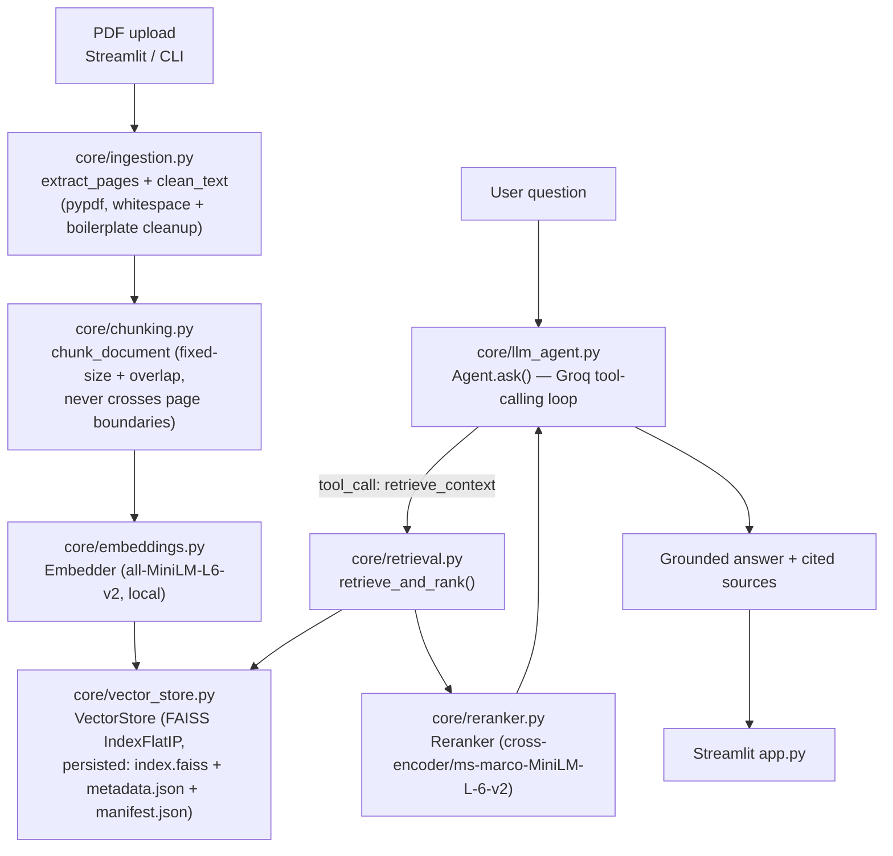
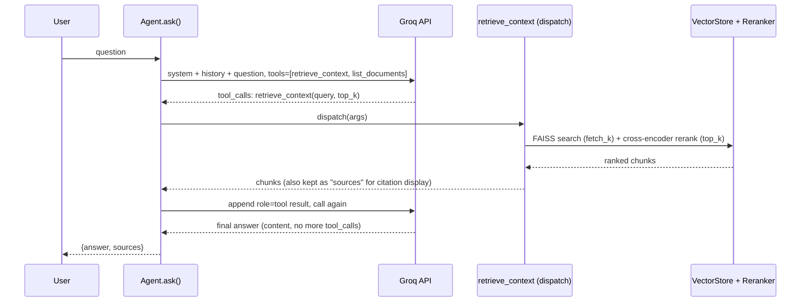

# Architecture

## Overview

The Document Assistant is a retrieval-augmented generation (RAG) pipeline built entirely in
vanilla Python — no LangChain/LangGraph/CrewAI. LLM calls, tool-call parsing/dispatch, and
conversation-history management are hand-rolled directly against the Groq SDK.

## Components

| Module | Responsibility |
|---|---|
| `core/ingestion.py` | Extracts per-page text via `pypdf`, strips repeated running headers/footers and page-number-only lines, normalizes whitespace. Also computes a sha256 hash of each file for dedup. |
| `core/chunking.py` | `ChunkConfig` (chunk_size, overlap) + fixed-size character windowing per page. Chunks never span page boundaries, so citations stay page-accurate. |
| `core/embeddings.py` | Wraps `sentence-transformers` (`all-MiniLM-L6-v2`, 384-dim, fully local/open-source). `encode_normalized` L2-normalizes so FAISS inner product = cosine similarity. |
| `core/vector_store.py` | Owns the persistent store at `data/vector_store/`: `index.faiss` (FAISS `IndexFlatIP`), `metadata.json` (chunk text/page/source, position-aligned with the index), `manifest.json` (embedding model/dimension + ingested-file hashes for dedup). Writes are atomic (temp file + `os.replace`). Raises `EmbeddingModelMismatchError` if the persisted store was built with a different embedding model. |
| `core/reranker.py` | Cross-encoder (`cross-encoder/ms-marco-MiniLM-L-6-v2`) that jointly scores (query, chunk) pairs — the explicit "ranking" phase, distinct from raw FAISS top-k. |
| `core/retrieval.py` | `retrieve_and_rank()`: over-fetches ~20 FAISS candidates, then reranks down to the top-k requested. |
| `core/prompts.py` | `SYSTEM_PROMPT` (grounding + citation instructions) and the context-block template — the project's prompt templates. |
| `core/tools.py` | Groq tool JSON schemas (`retrieve_context`, `list_documents`) + a dispatch table mapping tool name → real Python function. |
| `core/llm_agent.py` | `Agent.ask()` — the tool-calling loop (see below). |
| `core/pipeline.py` | `DocumentAssistant` facade: `ingest_pdf()`, `ask()`, `list_documents()`, `clear()`. Everything else (`app.py`, `scripts/`, `notebooks/demo.ipynb`) calls this, not the lower-level modules directly. |
| `app.py` | Streamlit UI: sidebar upload/ingest/clear, main chat pane with per-turn source citations. |
| `evaluation/evaluate_chunking.py` | Builds isolated in-memory indexes per `ChunkConfig` and compares retrieval quality — the "compare multiple chunk sizes" deliverable. |

## Tool-calling sequence

Native Groq function-calling drives retrieval, rather than an always-retrieve chain:

- Capped at `MAX_TOOL_ITERATIONS = 4` rounds; if hit, a final no-tools completion forces a
  textual answer rather than looping forever.
- Only clean `{"role","content"}` turns are appended to the long-lived conversation `history`;
  the tool-call scaffolding (`role: "assistant"` with `tool_calls`, `role: "tool"` results) stays
  local to that turn's request, keeping context growth bounded over a long chat.
- The system prompt (`core/prompts.py`) instructs the model to answer only from retrieved
  content, decline when context is insufficient, and cite `source`/`page` — verified in practice
  (see `docs/evaluation_report.md`).

## Persistence design

- `data/vector_store/index.faiss` — the FAISS vector index.
- `data/vector_store/metadata.json` — one entry per chunk (`id`, `text`, `page`, `source`,
  `chunk_size`, `overlap`), array-position-aligned with the FAISS index.
- `data/vector_store/manifest.json` — embedding model name/dimension (for mismatch detection)
  and a map of ingested file sha256 hashes → filename/chunk-count/timestamp (for dedup and the
  "documents in knowledge base" UI list).
- Ingesting the same file twice is a no-op (`VectorStore.is_ingested`); ingesting a new file
  incrementally embeds and appends to the existing index rather than rebuilding it.
